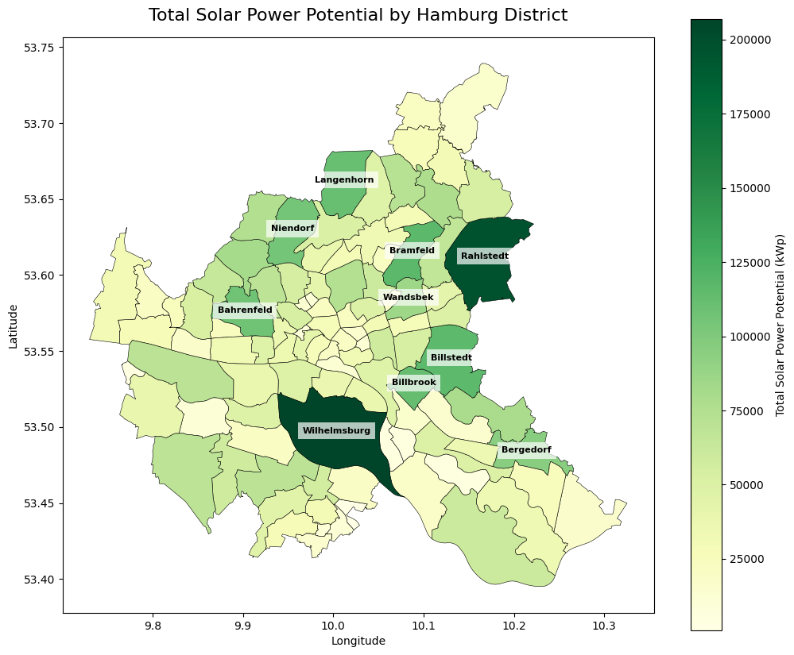
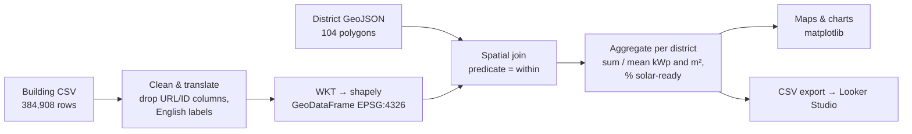
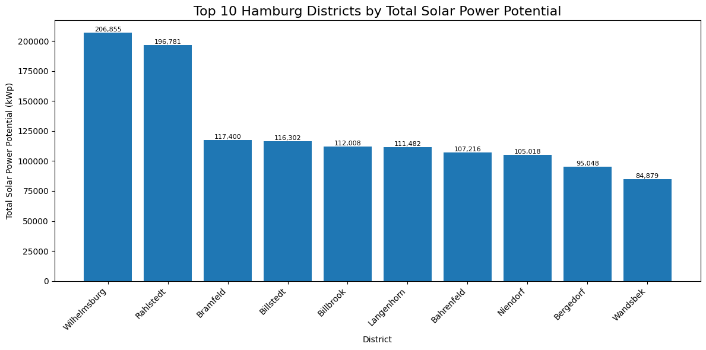

# Rooftop Solar Potential Across Hamburg's Districts

A geospatial analysis of the official Hamburg rooftop-solar dataset (384,908 building records) that assigns every building to one of Hamburg's 104 districts (*Stadtteile*) and ranks the districts by total solar capacity, solar readiness and rooftop area.

Team project, ReDI School of Digital Integration — Data Analytics, Spring 2026.

[](https://github.com/Dhru1999/Renewable-Solar-Potential-Across-Hamburg-District-Analysis/actions/workflows/ci.yml)



## The question

Hamburg aims to be climate-neutral by 2045, and rooftop PV is one of the levers it can pull inside the city. The city publishes a modelled solar potential for every building, but only with street addresses — not with district names. So the dataset cannot answer the planning question directly:

> **Which districts offer the greatest opportunity for rooftop solar expansion, and is that because of many buildings, large roofs, or well-suited roofs?**

Answering it means joining 385k building polygons to district boundaries and aggregating.

## Team

| Name | Role |
|---|---|
| Bahareh Fatemi | Geospatial analysis and Python development |
| Dhrupti Pambhar | Project planning, dashboard and insight generation |
| Zainab Olukoga O. | Renewable-energy research, dashboard and Python development |

## Data

| Dataset | Source | Licence | Notes |
|---|---|---|---|
| *Solarpotenzialflächen Hamburg* — one row per building: suitability class, modelled peak power (kWp), usable PV area (m²), footprint polygon | [Hamburg Transparency Portal](https://suche.transparenz.hamburg.de/dataset/solarpotenzialflaechen-hamburg9), published by Landesbetrieb Geoinformation und Vermessung | Datenlizenz Deutschland – Namensnennung 2.0 | The CSV export used here (~224 MB, `;`-separated) stores polygons as WKT in EPSG:4326. Not committed to the repo. |
| Hamburg district boundaries (GeoJSON, 104 *Stadtteile*) | [GitHub gist by Kilie](https://gist.github.com/Kilie/179dca3a1dfd103be692357160a7c8be) | Not stated in the gist | Community-maintained; the boundaries are not the official ALKIS data. |

Things to know about the building data:

- The suitability class is modelled from solar irradiation (*Eignung* 1 = very high irradiation … 6 = low). Two classes are not rooftops at all: *Eignung 8* (no building detected, 9,070 records) and *Eignung 0* (insufficient data quality, 325 records).
- `power` is **peak capacity in kWp**, not annual energy (kWh). Nothing in this project converts it to energy yield, cost or CO₂ savings.
- 10 `buildingid` values occur twice with different geometries; the team kept them (0.003 % of rows).

## Method



1. **Clean** – drop internal IDs and calculator URLs, rename columns to English, translate the six suitability labels, drop the address column (41.7 % of addresses were empty and none contained a district).
2. **Geometry** – parse WKT polygons with shapely and build a GeoDataFrame. The district GeoJSON is already in EPSG:4326, so no reprojection was needed.
3. **Spatial join** – assign each building to the district polygon that fully contains it (`gpd.sjoin(..., predicate="within")`).
4. **Aggregate** – per district: number of buildings, total and average kWp, total and average PV area, and the share of *solar-ready* buildings (suitability Very High, High or Moderate).
5. **Validate coverage** – check how many buildings and districts were lost in the join (see below).
6. **Visualise** – choropleth maps and rankings in matplotlib; the district table was exported to CSV and turned into a Looker Studio report ([PDF export](Redi_School_Spring_2026___Final_Project.pdf)).

### Join quality

| Check | Result |
|---|---|
| Buildings assigned to a district | 384,525 of 384,908 (99.90 %) |
| Buildings not assigned | 383 — polygons crossing a district boundary or slightly outside every polygon |
| Districts with at least one building | 103 of 104 — only **Neuwerk** (island in the North Sea, administratively part of Hamburg) has none |

## Results

All figures below are outputs stored in the notebook unless marked otherwise.

**Suitability of all 384,908 records**

| Class | Records | Share |
|---|---:|---:|
| Very High | 108,838 | 28.3 % |
| High | 107,258 | 27.9 % |
| Moderate | 59,618 | 15.5 % |
| Low | 99,799 | 25.9 % |
| No Building | 9,070 | 2.4 % |
| Insufficient Data | 325 | 0.1 % |

71.6 % of all records (73.4 % of actual rooftops) fall in the solar-ready classes. Mean usable PV area is 108 m² and mean capacity 11.9 kWp per record; both distributions are strongly right-skewed — at least a quarter of records have a modelled capacity of 0 kWp, while a few very large roofs reach up to 4,906 kWp.

**Top 10 districts by total capacity**



| # | District | Total kWp | Buildings | Avg kWp / building | Solar-ready |
|---:|---|---:|---:|---:|---:|
| 1 | Wilhelmsburg | 206,855 | 13,022 | 15.9 | 70.2 % |
| 2 | Rahlstedt | 196,781 | 19,239 | 10.2 | 73.4 % |
| 3 | Bramfeld | 117,400 | 11,776 | 10.0 | 75.8 % |
| 4 | Billstedt | 116,302 | 11,737 | 9.9 | 75.9 % |
| 5 | Billbrook | 112,008 | 1,910 | 58.6 | 68.5 % |
| 6 | Langenhorn | 111,482 | 13,425 | 8.3 | 69.9 % |
| 7 | Bahrenfeld | 107,216 | 6,775 | 15.8 | 66.5 % |
| 8 | Niendorf | 105,018 | 12,696 | 8.3 | 73.6 % |
| 9 | Bergedorf | 95,048 | 9,276 | 10.2 | 71.2 % |
| 10 | Wandsbek | 84,879 | 5,485 | 15.5 | 74.1 % |

**Highest share of solar-ready buildings:** Neuenfelde (86.1 %), Harvestehude (86.0 %), Cranz (85.5 %), Langenbek (84.5 %), Francop (84.4 %).

**What the numbers say**

- Wilhelmsburg and Rahlstedt are clearly ahead, each with roughly 1.7× the capacity of the third district.
- They get there differently: Rahlstedt through the largest number of buildings (19,239) with average-sized roofs, Wilhelmsburg through many buildings *and* larger roofs (157 m² of usable PV area per building vs. 88 m² in Rahlstedt). Billbrook reaches the top 5 with only 1,910 buildings because its industrial roofs average 58.6 kWp each.
- High readiness does not mean high capacity: the most "ready" districts (Neuenfelde, Harvestehude, Cranz) are not in the capacity top 10.

The Looker Studio report additionally shows city-wide totals of about **4.58 million kWp** and **41.3 million m²** of usable PV area, and the ranking by average PV area per building (led by port and industrial districts such as Altenwerder, Kleiner Grasbrook, Waltershof and Billbrook). These come from the dashboard and are not printed in the notebook outputs.

## Repository contents

| Path | What it is |
|---|---|
| `Redi_School_Spring_2026___Final_Project.py.ipynb` | Team notebook (Google Colab) with all stored outputs |
| `Redi_School_Spring_2026___Final_Project.pdf` | Presentation / Looker Studio report export |
| `solar_analysis/pipeline.py` | The notebook's join-and-aggregate workflow as a tested, re-runnable script (added after the course, see below) |
| `tests/` | pytest tests on small synthetic geometries |
| `docs/images/` | Charts exported from the notebook outputs |

## Reproducing the analysis

```bash
git clone https://github.com/Dhru1999/Renewable-Solar-Potential-Across-Hamburg-District-Analysis.git
cd Renewable-Solar-Potential-Across-Hamburg-District-Analysis
python -m venv .venv && source .venv/bin/activate   # Windows: .venv\Scripts\activate
pip install -r requirements-dev.txt
python -m pytest -q
```

**Notebook:** open it in Jupyter or Colab and run all cells. Cell 5 downloads the team's copy of the building CSV from Google Drive with `gdown` and the district GeoJSON from the gist; if the Drive link is unavailable, download the CSV from the Transparency Portal and change the path.

**Script:** with the two files downloaded,

```bash
python -m solar_analysis.pipeline solar.csv hamburg_city_districts.geojson district_metrics.csv
# add --include-non-rooftops to count records the way the notebook did
```

It prints the join coverage and writes one row per district. The script reads the CRS from the data instead of assuming it, reprojects the districts if needed, reports unassigned buildings instead of dropping them silently, and fails on unknown suitability labels. It has been tested on synthetic data in CI; it has not been re-run on the full dataset in this repository.

## Limitations and known issues

- **Capacity, not energy.** kWp ignores orientation losses, shading over the year and consumption; it is an upper bound on installable peak power, not an energy-yield or investment estimate.
- **Non-rooftop records are counted in the notebook.** Its text says categories 0 and 8 were excluded, but the code keeps them in building counts and in the solar-readiness denominator. The effect is small (2.4 % of records, almost all with 0 kWp), but it slightly lowers readiness percentages. The script excludes them by default.
- **"Within" is strict.** 383 buildings crossing district boundaries are left out. Assigning by polygon centroid would keep them.
- **Notebook hygiene.**
  - The two "Average Rooftop Solar Area per Building" maps plot `avg_solar_power_kwp`, not `avg_pv_area`, and one says "Top 10" but labels five districts.
  - Some cells were edited after their stored outputs were produced (e.g. the colour map of Map 1), so re-running changes the look of a few charts.
  - The data download depends on a personal Google Drive link.
- **District boundaries** come from a community gist rather than the official ALKIS data, and their licence is not stated.

## Possible next steps

- Convert kWp to expected annual yield (kWh) with a published specific-yield assumption, clearly labelled as an estimate.
- Add energy-consumption or population data per district to compare potential with demand.
- Assign border buildings by centroid and compare rankings.
- Publish the Looker Studio report link if it can be made public.

## Acknowledgements

Data: Freie und Hansestadt Hamburg, Landesbetrieb Geoinformation und Vermessung (Datenlizenz Deutschland – Namensnennung 2.0). District boundaries: Kilie (GitHub gist). Built during the ReDI School Data Analytics course.
